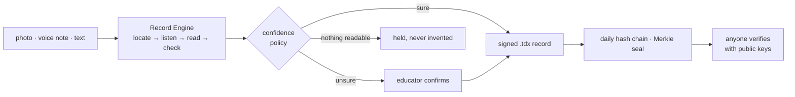

# TeacherDox Core

**Open infrastructure that turns a photo or voice note from any classroom into a signed teaching
record that anyone can verify.**

| Step | What happens | Model |
|---|---|---|
| locate | find the board in the photo and crop to it | **SAM 3.1** (Meta Model API) |
| listen | transcribe the voice note, in the educator's language | **Muse Voice Transcribe** (Meta Model API) |
| read | turn crop, transcript and text into structured fields, each with a confidence | **Muse Spark** (Meta Model API) |
| check | a second call checks every field against the evidence | **Muse Spark** (Meta Model API) |
| read, check (second provider) | the same steps on Meta's open weights | **Muse Spark Open** on Baseten |
| fallback | whatever the Meta models cannot do (e.g. Malayalam speech) | a model the host plugs in (e.g. Gemini) |



```bash
git clone https://github.com/sandeepkumareeri/teacherdox-core && cd teacherdox-core
node bin/tdx verify verifier/samples/day-demo.json --keys verifier/samples/keys-demo.json   # → VALID
```

No install: Node.js 22+, no runtime dependencies. Five minutes:
[`docs/quickstart.md`](docs/quickstart.md). One record end to end, with real output:
[`docs/how-a-record-is-born.md`](docs/how-a-record-is-born.md).

## How well the models do (measured, synthetic data)

12 synthetic board photos and 8 synthetic voice notes, each provider on its own. Full table, per
case, method and caveats: [`eval/RESULTS.md`](eval/RESULTS.md).

| | Meta Model API | Muse Spark Open (Baseten) | Gemini (`gemini-3.8-flash`) |
|---|---|---|---|
| Field accuracy, all 20 cases | **81%** | 69% | 77% |
| Boards | **98%** | **98%** | 82% (2 of 12 refused with HTTP 429; 98% on the rest) |
| Voice: en / hi / pt | 90 / 80 / 100% | 90 / 0 / 20% | 100 / 90 / 100% |
| Voice: Malayalam, Telugu | held (ml not supported; te not heard) | not heard | ml 1 of 2; te held |
| Time per record, p50 | **9.3 s** | 11.3 s | 16.1 s |
| Cost per record | not published | $0.0104 | not recorded |

Where Meta was weaker: Malayalam and Telugu voice notes, and the robotic synthetic voices may make
those numbers worse than real recordings would be. The Meta and Gemini columns come from two runs 44
minutes apart, because the Meta Model API answered 404 during the Gemini run. Twenty cases is a small
sample.

## What a record proves

Each locked record is RFC 8785 canonical JSON signed with Ed25519, linked by hash to the
educator's previous record that day, and can be covered by a signed Merkle root at the end of the day. A
verifier needs only the record and the institution's published public keys. It can show that the
record is unchanged since signing, who signed it with which key, and that no record of the day was
removed or inserted. It cannot show that the lesson happened as written. [`SECURITY.md`](SECURITY.md)
sets out what can and cannot be forged.

Corrections never edit a signed record: they are new records that point at the old one. Every
model step is written into the record (provider, model, time, tokens, cost), and fields the models
were unsure of are confirmed by the educator, never saved silently.

## What is in the repository

| Path | What |
|---|---|
| [`spec/tdx-2.0.md`](spec/tdx-2.0.md), [`spec/schema/`](spec/schema/tdx-2.0.schema.json) | The `.tdx` 2.0 record (RFC style) and its normative JSON Schema |
| [`spec/vectors/`](spec/vectors/README.md) | Test vectors with a published test key, so other implementations can check themselves |
| `src/tdx/` | Reference implementation: canonical form, signing, chain, amendments, seals, countersignatures, schema validator. No dependencies, type-checked |
| `src/engine/` | Record Engine: capability router with fallback, providers (Meta Model API, Baseten, host-supplied), confidence routing |
| [`packs/`](packs/README.md) | Languages (en, ml, te, hi, pt-BR, id, fr), institution types, countries, policies |
| `src/api/` | REST API `/v1`: capture, confirm, amend, countersign, seal, verify, telemetry ([`docs/api.md`](docs/api.md)) |
| [`verifier/`](verifier/index.html) | Verifier page: checks records in the browser with WebCrypto, nothing uploaded |
| `bin/tdx` | CLI: `verify`, `validate`, `hash`, `keygen`, `process`, `serve` |
| [`eval/`](eval/RESULTS.md) | Evaluation harness and results |
| [`docs/meta-model-api-notes.md`](docs/meta-model-api-notes.md) | What was observed calling Meta's models |

```bash
npm test              # 90 tests, Linux and Windows
npm run typecheck     # after npm install (dev dependencies only)
npm run coverage
```

CI runs all three plus CodeQL on every push. Contributing: [`CONTRIBUTING.md`](CONTRIBUTING.md).
Changes: [`CHANGELOG.md`](CHANGELOG.md). Built during the Meta Global AI Developer Hackathon
(26 Oct – 4 Nov 2026); [`HACKATHON.md`](HACKATHON.md) logs what was built and when.

## Using it from code

```js
const { createRecordEngine, fromGenerate } = require('./src/engine');
const tdx = require('./src/tdx');

const engine = createRecordEngine({ fallback: fromGenerate(hostGenerate), dailyLimit: { meta: 500 } });
const { capsule, routing } = await engine.process({
  evidence: [{ bytes: boardJpeg, media_type: 'image/jpeg' }],
  context: { tenant: 't_1', educator_ref: 'e_1', institution_ref: 'i_1', institution_type: 'school',
             country: 'IN', locale: 'en-IN', date: '2026-10-28', channel: 'whatsapp' },
});
// routing.decision: 'auto_lock' | 'confirm' | 'hold'
const record = tdx.lock(capsule, { key, state: 'auto_locked' });
tdx.verifyCapsule(record, { keys: [publicEntry] });   // → { ok: true, hash, errors: [] }
```

`hostGenerate` is any function that takes a Gemini `generateContent` request and returns its response.
The core never calls Google itself; `hosts/gemini.js` is the one this repository's scripts use.

## License

Apache-2.0 (see [`LICENSE`](LICENSE) and [`NOTICE`](NOTICE): TeacherDox Core — Copyright 2026
TeacherDox Private Limited). The `.tdx` format is open so that institutions, ministries and software
vendors can read, store and verify teaching records without depending on TeacherDox.
