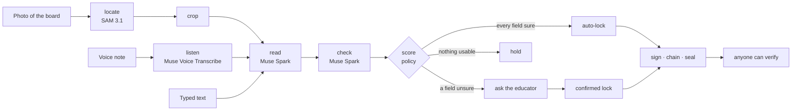
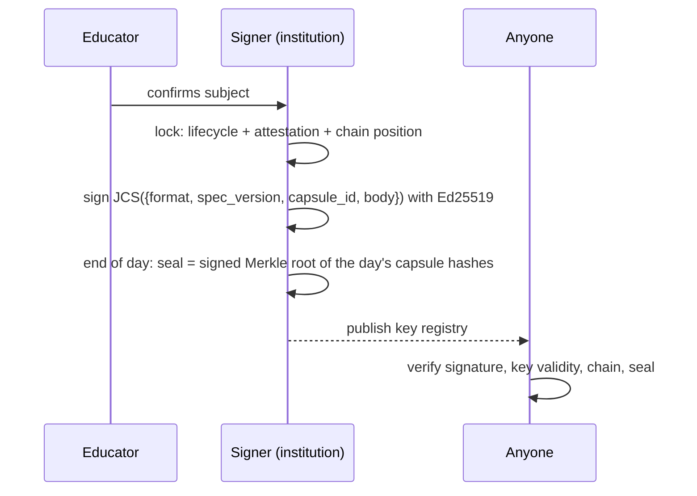

# How a record is born

From a photo of a classroom board to a signed, verifiable `.tdx` record, step by step. Everything
below is **real output**: the model steps come from the live run
[40671823349](https://github.com/sandeepkumareeri/teacherdox-core/actions/runs/40671823349) on
28 October 2026 (GitHub Actions, Meta Model API). The confirmation, signing and seal were done
with [`docs/examples/confirm-and-sign.js`](examples/confirm-and-sign.js), which anyone can re-run
to get byte-identical results. The photo is synthetic
([`test/fixtures/board-synthetic.jpg`](../test/fixtures/board-synthetic.jpg)); no real classroom
data is used anywhere in this repository.



## 1. Capture

The educator sends a photo of the board (the product uses WhatsApp; here the API is called with
the file). The engine never stores the photo inside the record: it records the photo's **content
hash**, so whoever holds the file can prove it is the same one.

```json
"evidence": [
  { "id": "sha256:462bd34b25763047a8c3d2abd60bef95913af70c0500f4522e38b91de6c7300b",
    "media_type": "image/jpeg", "bytes": 57499, "role": "board" }
]
```

Check it yourself: `sha256sum test/fixtures/board-synthetic.jpg` (PowerShell:
`Get-FileHash test/fixtures/board-synthetic.jpg`) prints the same hash.

## 2. Locate: SAM 3.1 finds the board (1.5 s)

Meta's segmentation model is asked for the chalkboard or whiteboard. It returned the box
`[0.1117, 0.1292, 0.8883, 0.7875]` (fractions of the width and height). The board drawn in the
synthetic photo is about `[0.109, 0.125, 0.891, 0.792]`. The engine crops the photo to the box
(43,718 bytes) so the next model reads the board rather than the room. Without `ffmpeg`, or if
SAM 3.1 is unavailable, the whole photo is read and the record says so.

## 3. Read: Muse Spark structures the session (8.6 s)

Muse Spark gets the crop, the educator's context (school, country, language, timetable if known)
and a strict JSON schema, and returns the fields with a confidence for each:

| Field | Value | Confidence |
|---|---|---|
| cohort | 8B | 1.0 |
| subject | Mathematics | (checked next) |
| unit | Fractions | 1.0 |
| title | Adding fractions with unlike denominators | 0.8 |
| topics | Common denominators · LCM · Addition of unlike fractions | 0.9 |
| homework | Ex 3.2 Q1-5 | 1.0 |

1,274 tokens in, 1,513 out (reasoning included).

## 4. Check: a second Muse Spark call cross-examines the reading (5.5 s)

A separate call sees the same evidence and the proposed fields, and must say for each field
whether the evidence supports it. Here it found one problem:

```json
"flags": [
  { "field": "session.subject", "issue": "unsupported",
    "detail": "Board shows Fractions only, not word Mathematics." }
]
```

That is correct: the board never says "Mathematics"; the reader inferred it. The check step lowers
the subject's confidence to 0.5.

## 5. Score: the policy decides who must look (instant)

The `school_compliance` policy treats `subject` as a critical field that needs 0.9. Every other
field passed, so only the subject goes to the educator:

```json
"routing": {
  "decision": "confirm",
  "policy_profile": "school_compliance",
  "confirm_fields": ["session.subject"],
  "reasons": ["session.subject confidence 0.50 < 0.9 (critical)"]
}
```

The educator sees one line, *"Recorded. Please check: subject."*, not a form. Had nothing been
readable, the record would have been **held** with empty fields; the engine never invents content.

The result is a **draft** capsule: [`examples/live-draft.json`](examples/live-draft.json), exactly as
the live run produced it, valid against the [JSON Schema](../spec/schema/tdx-2.0.schema.json).
Every step is in its provenance (provider, model, milliseconds, tokens and cost; the cost is `null`
because Muse Spark's price is not published, and is never estimated):

| step | provider | model | ms | tokens in / out |
|---|---|---|---|---|
| locate | meta | sam-3.1 | 1,496 | — |
| read | meta | muse-spark-1.3 | 8,552 | 1,274 / 1,513 |
| check | meta | muse-spark-1.3 | 5,542 | 1,215 / 1,122 |

Total 15.7 s. In the same run, the same photo read by **Muse Spark Open on Baseten** (Meta's open
weights; SAM 3.1 still on the Meta Model API) gave the same cohort, subject, unit and homework in
6.6 s + 6.4 s for $0.0056 + $0.0047. It rated the subject 0.8, below 0.9, so it was also sent to
the educator.

## 6. Confirm and lock

The educator answers "Mathematics is right". The draft becomes a **locked** capsule: the body the
models produced is unchanged (the test suite checks this), and three things are added.



```json
"lifecycle": { "state": "confirmed_locked" },
"attestation": {
  "statement_ref": "tdx:attestation/reasonable-representation/1.0",
  "mode": "human",
  "policy_profile": "school_compliance", "policy_version": "1",
  "auto_accepted_fields": ["session.cohort", "session.unit", "content.assignments", "content.topics",
                           "content.title", "content.summary", "content.method"],
  "confirmed_fields": ["session.subject"],
  "edited_fields": [],
  "confirmation": { "by": "e_demo", "at": "2026-10-28T10:30:41Z", "channel": "whatsapp" }
},
"chain": { "sequence_index": 0, "prev_hash": null }
```

The attestation says exactly what a person confirmed and what the policy accepted on its own. The
chain position makes this the first record of the educator's day; the next one will carry this
record's hash as its `prev_hash`.

## 7. Sign

The signer serialises `{format, spec_version, capsule_id, body}` in the RFC 8785 canonical form
and signs it with Ed25519:

```json
"signature": {
  "alg": "ed25519",
  "key_id": "tdx-test-2026",
  "signed_at": "2026-10-28T10:31:00Z",
  "sig": "lvhmQlP-YS_DETsufJiN783gUuKOe-S34dw8K4lNDazivmJY5lbm3LhcHAr_BOZIz_8RR19NfgoxGa9BfaWlDw"
}
```

Capsule hash (SHA-256 of the whole signed envelope):
`sha256:f49d8b51e3d42225b07ae256b4fd0aa62c8958a9bfb6abc9bb17c333eee626ac`.
Full record: [`examples/live-signed.json`](examples/live-signed.json).

This example is signed with the **published test key** from [`spec/vectors/`](../spec/vectors/README.md)
so that you can reproduce it. Anyone can sign with that key, so this signature proves nothing about
a real record. A real deployment uses its own key (`tdx keygen`) and publishes only the public half.

## 8. Seal the day

At the end of the day the signer signs a Merkle root over every locked capsule hash of that
educator-day ([`examples/live-seal.json`](examples/live-seal.json)):

```json
{ "type": "tdx-day-seal", "scope": "t_demo|e_demo|2026-10-28", "count": 1,
  "merkle_root": "bf9b6f11c22f87f08cf2df01e53164bfa16128983fec759195d5971023c3eab4",
  "sealed_at": "2026-10-28T14:30:00Z", "signature": { "alg": "ed25519", "key_id": "tdx-test-2026", "sig": "XUUl…HDw" } }
```

A headmaster can countersign the seal, which approves the whole day with one signature. A Merkle
proof shows that one record belongs to the sealed day without revealing the others.

## 9. Verify

```bash
node bin/tdx verify docs/examples/live-signed.json --keys docs/examples/keys.json
```

```
✓ 01a1820b-0000-7000-8000-000000000001  confirmed_locked  2026-10-28 · 8B · Mathematics · Fractions
✓ day t_demo|e_demo|2026-10-28: 1 signed, chain intact, not sealed
VALID
```

The same check runs in the browser on the verifier page (`tdx serve`, then `/verify/`), using a
second implementation built on WebCrypto. Change any character of the record and verification fails
with `signature_mismatch`. What a valid result does and does not prove is set out in
[`SECURITY.md`](../SECURITY.md#what-verification-proves).

## Reproduce it

```bash
node docs/examples/confirm-and-sign.js     # rewrites live-signed.json, live-seal.json, keys.json: identical bytes
git diff --exit-code docs/examples/        # no changes
```

The model steps (1–5) need a Meta Model API key and give slightly different wording on each run.
The workflow [`photo-live.yml`](../.github/workflows/photo-live.yml) runs them on the synthetic
board and prints the draft capsule in its log.
