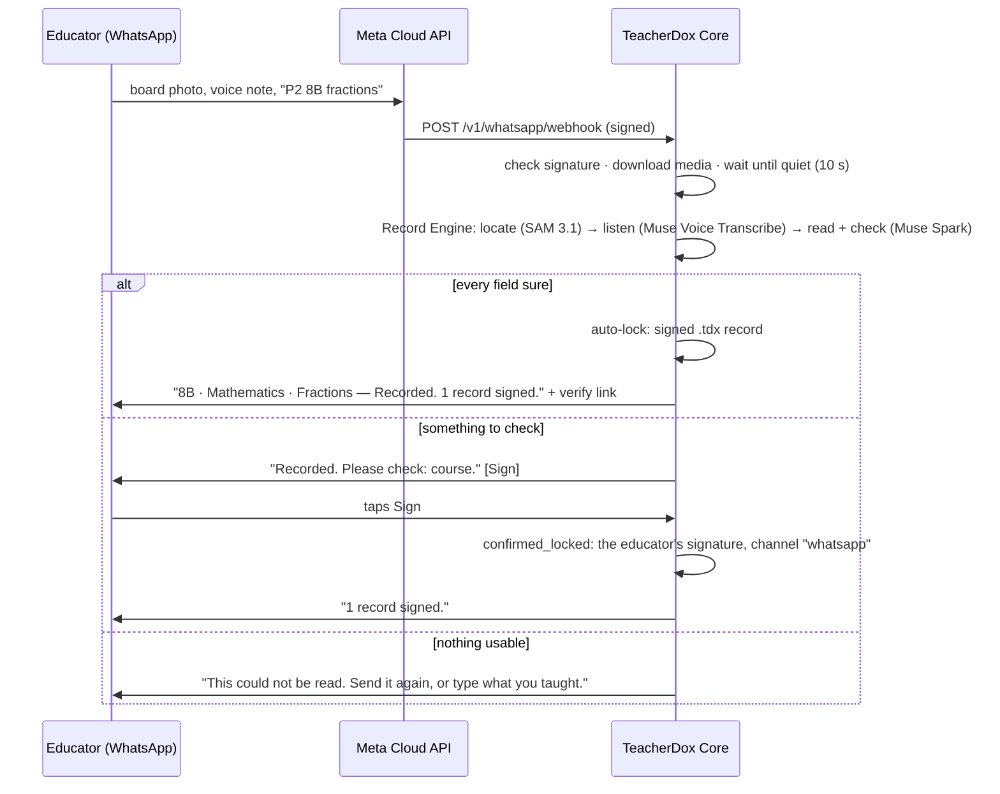

# WhatsApp channel

TeacherDox is **WhatsApp-first teaching records infrastructure**. An educator does not install an
app or fill a form: after a class they send what they already have — a photo of the board, a voice
note, a line of text — to a WhatsApp number. The channel turns those messages into one `.tdx` record
through the Record Engine, and the educator signs it with one tap.

The channel speaks the **WhatsApp Cloud API** (Meta, direct) and has no dependencies. It is in
`src/channels/whatsapp/`:

| File | What |
|---|---|
| `cloud-api.js` | The wire: webhook signature check (`X-Hub-Signature-256`), the verification handshake, webhook parsing, and a Graph API client (download media, send text, send reply buttons) |
| `index.js` | The channel: groups an educator's messages into one capture, runs it, replies, and turns a "Sign" tap into a signed record |

## What happens to a message



- **One capture, many messages.** Photos, voice notes and texts from one educator are collected until
  they have been quiet for `quietMs` (10 s by default), then processed as one record. Media are
  downloaded as soon as they arrive, because Cloud API media ids expire.
- **Replies in the educator's language and vocabulary.** The reply is `packs.describe()` from the
  locale and institution packs: a school teacher is asked about the *class* and *subject*, a college
  lecturer about the *course*, in any of the locale packs (en, hi, te, ml, pt-BR, id, fr).
- **The educator signs, not the machine** — unless the policy lets a fully supported record auto-lock.
  A "Sign" tap, or replying "sign", locks the draft as `confirmed_locked` with
  `attestation.mode: "human"` and `confirmation.channel: "whatsapp"`.
- **Nothing is invented.** An unreadable or off-topic capture is held and the educator is told why; no
  record is signed from it.

## Security and privacy

- Every webhook delivery must carry a valid `X-Hub-Signature-256` made with the app secret; anything
  else gets `401` and is not processed. The API refuses to start the channel without an app secret
  (`allowUnsigned: true` exists for local tests only).
- Meta retries deliveries; message ids already seen are ignored.
- **The phone number never enters a record.** `educator_ref` is `wa_` + a keyed hash
  (HMAC-SHA256 of tenant and number, 96 bits). The number is used only to reply.
- A "Sign" button carries the entry id; a tap from any other number than the educator's is refused.

## Setting it up

1. In Meta's developer dashboard: an app with the WhatsApp use case, a business phone number on the
   Cloud API, and a **permanent System User token** (`whatsapp_business_messaging`).
2. Start the API with the channel switched on:

   ```bash
   WHATSAPP_TOKEN=…            # System User token
   WHATSAPP_PHONE_NUMBER_ID=…  # the number's Phone number ID (not the number)
   WHATSAPP_APP_SECRET=…       # App settings → Basic → App secret
   WHATSAPP_VERIFY_TOKEN=…     # any string; the same one goes into Meta's dashboard
   TDX_WHATSAPP_TENANT=t_demo
   TDX_WHATSAPP_INSTITUTION_REF=i_demo
   TDX_WHATSAPP_INSTITUTION_TYPE=school   # or college, university, academy, training, independent
   TDX_PUBLIC_URL=https://records.example.org
   META_API_KEY=…              # the Record Engine's Meta Model API key
   node bin/tdx serve --host 0.0.0.0 --port 8080
   ```

3. In the dashboard, WhatsApp → Configuration: callback URL `https://<your host>/v1/whatsapp/webhook`,
   the same verify token, **Verify and save**, and subscribe to the `messages` field.
4. Send a board photo to the number.

`createApi({ whatsapp: { client, appSecret, verifyToken, tenant, institution_ref, institution_type,
country, locale, quietMs, verifyUrl } })` does the same from code; `client` is
`createClient({ token, phoneNumberId })` or anything with `downloadMedia`, `sendText` and
`sendButtons`.

## Tested

`test/whatsapp.test.js` (synthetic webhooks in Meta's documented shape, no network):
signature accepted / refused (wrong secret, changed body, missing header); handshake; parsing of
photos, voice notes, image and audio documents, text, reply buttons and delivery statuses; the Graph
client's two-step media download and message bodies (at most 3 buttons, titles at most 20
characters); and end to end through the API — photo + text → one auto-locked, verifiable record with
no phone number in it; a college capture without a course → "Please check: course" → Sign →
`confirmed_locked` by the lecturer; another number's tap refused; "sign" as text; unclear and
off-topic captures held.

Not yet measured: a live run against Meta's Cloud API from this repository. The TeacherDox product
runs on WhatsApp today through its own integration (private repository).
